<div align="center">

<a href="https://s1spa.dev"></a>

<a href="https://s1spa.dev"></a>

<p>
  <a href="https://s1spa.dev"></a>
  <a href="https://linkedin.com/in/illya-avdosev-845b0932a"></a>
  <a href="mailto:avdosevg@gmail.com"></a>
</p>

</div>

---

### `// whoami`

```js
const s1spa = {
  name:       "Illia Avdosiev",
  role:       "Game & app developer",
  builds:     ["games", "apps", "Discord bots", "game mods"],
  experience: ["Infinium Game Studio — Unity / C# intern", "Kness — Software Engineer intern · AI / Web"],
  education:  "VNTU — Master's, Software Engineering",
  status:     "open to junior roles",
};
```

---

### `// stack`

<p>
  
  
  
  
  
  
  
  
  <br>
  
  
  
  
  
  
  
  
</p>

---

### `// featured`

| | Project | What it is | |
|:-:|---|---|---|
| ▲ | **[Chaos Events](https://github.com/s1spa/LC_EventsMod)** | Lethal Company mod — 13 random events with RPC network sync and in-terminal settings | **5,500+** downloads · [Thunderstore](https://thunderstore.io/c/lethal-company/p/s1spa/Chaos_Events/) |
| ▲ | **[Skin Changer](https://github.com/s1spa/Skinchanger-CP2077mod)** | Cyberpunk 2077 mod in RedScript — auto-discovered weapon skins right in the inventory | **1,000+** downloads, community fork **5,000+** · [Nexus](https://www.nexusmods.com/cyberpunk2077/mods/32426) |
| ▲ | **[Marvel Rivals UA](https://github.com/s1spa/Ukrainian-Localization-Marvel-Rivals)** | Unofficial Ukrainian localization — UI, abilities, shop, events, battle pass | **~60,700** lines · Gemini/DeepL-assisted pipeline |
| ▲ | **Rainbow** | Multi-bot system for Discord — multi-channel music, 4 AI characters with memory, moderation | ~10 servers · private repo |
| ▲ | **[ZeroTip](https://shramix.itch.io/zerotip)** | Unity game built by a team of three in 3 days at a game jam — time rewind, teleport, shadows | [itch.io](https://shramix.itch.io/zerotip) |

<sub>→ Screenshots, details and more projects: <a href="https://s1spa.dev/projects.html"><b>s1spa.dev/projects</b></a></sub>

---

### `// activity`

<div align="center">


<picture>
  <source media="(prefers-color-scheme: dark)" srcset="https://raw.githubusercontent.com/s1spa/s1spa/output/snake-dark.svg">
  
</picture>

</div>

---

<div align="center">
<sub><code>// s1spa.dev</code> · built with red neon and too much coffee</sub>
</div>
