  
  
  

<h2>// whoami</h2>

<h2>// stack</h2>

    
  
  
  
  
  
  
  
   
    
  
  
  
  
  
  
  

<h2>// featured</h2>

  
  
  
  
  
  

<h2>// activity</h2>

  
  

  <picture>
    <source media="(prefers-color-scheme: dark)" srcset="https://raw.githubusercontent.com/s1spa/s1spa/output/snake-dark.svg">
    
  </picture>

<code>// s1spa.dev</code> · built with red neon and too much coffee

